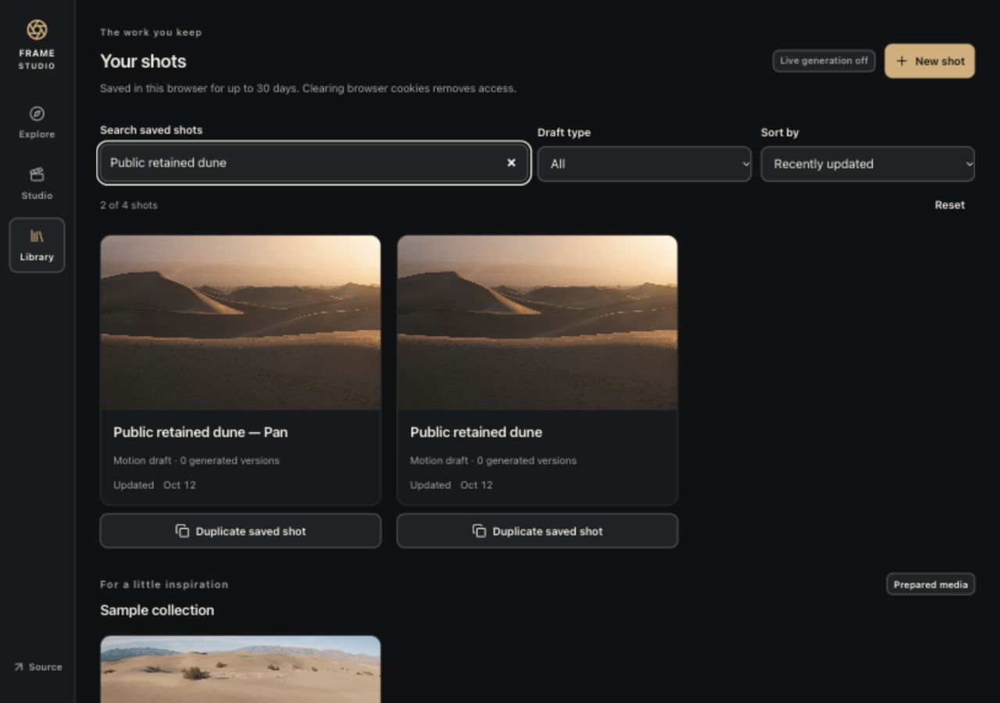

# Frame Studio · Higgsfield rebuild

A focused creative studio for the 8x assignment. Explore a prompt direction, compose a shot, retain its inputs, preserve an original, try a different camera direction, and take an exact shot brief with you.

**The integrated application is public:** Explore, Studio, Library, private uploads and saved guest drafts run on Cloudflare Workers, D1 and private R2. Live generation remains disabled with every allowance at zero. Real AI generation and the actual camera-on walkthrough are still unverified.

- [Live application](https://higgsfield-rebuild.arhaan2.workers.dev)
- [Public source](https://github.com/Arhaan2/higgsfield-rebuild)
- [Current evidence](docs/verification/INDEX.md) and [phase status](docs/STATUS.md)
- Camera-on walkthrough: **not recorded**; [4:25 walkthrough script](docs/WALKTHROUGH-SCRIPT.md).

## Product choices

[Signed-in research](docs/RECON.md) found useful prompt reuse and draft continuity, as well as a displayed-free flow with a paid fallback warning. The rebuild focuses on consistent task/model/action labels, visible start-frame semantics, retained inputs, and a server-enforced spending boundary. History and reuse already exist in Higgsfield; our proposed improvement is clearer local context, not invention of those features.

The user explicitly allowed implementation with the documented research gaps unverified. [Design decisions](docs/DESIGN-BRIEF.md) apply the installed Apple Design skill to a charcoal, ivory and brass cinematic workspace.

## Current verification

Published source **c89cde214b64739b179991d02686c4edcbea0655** is Cloudflare version **ffdcad33-1b55-44c7-bf6f-a09fa1162a68**, deployed 2026-10-12 at 20:52 UTC. [Version metadata](docs/verification/creative-cloudflare.json) confirms existing D1/private R2, exact origin, generation disabled and zero budget. No migration, provisioning or dependency changes. Later evidence/capture commits preserve this product source.

**Duplicate saved shot** preserves an original while creating a new saved draft with the same inputs and reference, zero generated history and no preferred output. Frozen creation identity and dedicated recovery support explicit retry without silently rotating the guest. The collapsed **Camera direction ideas** offers three editable writing suggestions, explicit replacement and guarded exact Undo. The optional **Camera study · 5 seconds** moves the actual reference locally, with Play/Stop/Replay and reduced-motion handling; it is not an AI-generated video.

Existing exact Markdown brief export, Library search/filter/sort, preview jump and primary Save action remain available. Save now explains when normalized saved text differs from visible outer whitespace; Export retains the exact visible draft.

Fresh TypeScript/build and **264 controlled checks** pass (36 server,58 Studio,52 Library,29 reference,26 export,11 duplicate,22 directions,18 camera,12 movement). All **11 hosted HTTP checks** pass on this release. [Local acceptance](docs/verification/creative-local.md), [independent repair review](docs/verification/creative-integration-review.md) and [actual public workflow](docs/verification/creative-public.md) record original/copy independence, uploaded-reference persistence, playback, exact/stale Undo, save/reload, keyboard/390 px and actual downloaded brief content. Failure injections remain controlled evidence; real generation remains unverified.



The earlier Sites URL remains a historical sample shell; its failed integrated deployments are preserved in [deployment history](docs/verification/deployment.md). Use the Workers URL above for evaluation.

## Run locally

Use Node 24.18 or newer for the included isolated test tooling, and npm. The app uses the supplied Sites Vinext starter, React/TypeScript, D1 and private R2. Exact dependency versions are in package-lock.json.

```sh
npm run install:ci
cp .env.example .env.local
npm run dev
```

Preview: http://127.0.0.1:5173 . On a new checkout, build once and apply the initial local migration once before saving drafts:

```sh
npm run build
node --import ./scripts/sites-env.mjs ./node_modules/wrangler/bin/wrangler.js d1 execute DB --local --config dist/server/wrangler.json --persist-to .wrangler/state --file drizzle/0000_cute_daredevil.sql
```

Do not replay an applied migration or alter migration history. D1 has seven tables and ten guards; no positive budget policy is seeded. Local and hosted state are separate. The direct Cloudflare database already has its initial migration applied; the deployment route reuses it without replay. Older Sites publishing attempts failed their migration runner.

```sh
npx tsc --noEmit
npm run build
node --import ./tests/server/register.mjs --test tests/server/*.test.mjs
node src/client/checks/studio-state.mjs
node src/client/checks/library-state.mjs
node src/client/checks/reference-action.mjs
node src/client/checks/shot-brief.mjs
node src/client/checks/duplicate-shot.mjs
node src/client/checks/prompt-directions.mjs
node src/client/checks/camera-study.mjs
node src/client/checks/movement-edit.mjs
```

Controlled checks use isolated SQLite and mocked provider/R2 or client APIs; they do not prove real generation. `node scripts/verify-http.mjs http://127.0.0.1:5173` runs actual zero-spend HTTP checks and creates isolated guest test records. It refuses to continue if generation policy is enabled or has a nonzero cap. [Historical local evidence](docs/verification/local-browser.md) and [earlier repair review](docs/verification/submission-review.md) retain their original source boundaries.

`APP_ORIGIN` must exactly match the browser origin. `LIVE_GENERATION_ENABLED=false` and `GENERATION_BUDGET_USD=0` are the defaults. `FAL_KEY` is optional and server-only; a key alone does not enable generation. D1's separate budget policy also defaults to no allowance. Do not put populated secrets in tracked files or chat.

## Scope and limitations

The implementation target includes validated JPEG/PNG start frames, same-browser guest drafts, immutable media, connected reuse and two fixed fal models: FLUX schnell images and Kling 2.5 Turbo Pro five-second videos. Provider submission/retrieval, billing, and real deployed generation remain unverified. Total authorized spending is $0. Keep generation disabled unless an authorized genuinely no-cost path is verified; no paid allowance is assumed or requested. Unknown submission outcomes must not auto-resubmit. Request-driven reconciliation pauses when every browser tab closes.

Guests are private per browser cookie, with access for up to 30 days; this is not cross-device account synchronization. There is no billing UI, collaboration suite, node editor, or broad Higgsfield feature/model parity.

[Dune study media](docs/design/sample-provenance.md) is licensed prepared photography and independent stock footage. It was not created from the example prompt or generated by this application. Samples never stand in for a live result.

## Capture and delivery

[CAPTURE-TEST.md](CAPTURE-TEST.md) records actual independent canaries. Desktop and separate CLI specialist sessions are automatically captured in tracked `.agent-logs/`; native children and worktrees remain unverified and unused for production. [Capture operation](docs/capture/README.md) explains provenance and the read-only audit.

```sh
PYTHONDONTWRITEBYTECODE=1 python3 scripts/capture/verify.py
```

[Workflow](docs/WORKFLOW.md), [decisions](docs/DECISIONS.md), [acceptance](docs/ACCEPTANCE.md) and [specialist contracts](docs/agents/ASSIGNMENTS.md) preserve the incremental evidence. The actual creation-path gate and Arhaan's camera-on walkthrough under five minutes remain delivery requirements. Public integrated entry and data paths now pass. The previous [138-check repair review](docs/verification/submission-review.md) covers durable preferences, new-upload selection and preset-only previews. Native accessibility preferences and physical-phone checks remain unrun.

The current capture audit distinguishes full-source coordinator/specialist records from **four** automatic client-suggestion sessions with exact native-journal matches but unavailable full transcripts. Updated Codex 0.162 capture was revalidated with two genuine independent canaries. See [capture documentation](docs/capture/README.md). No raw log was rewritten. The current coordinator final can only be captured after emission and must be committed afterward.
