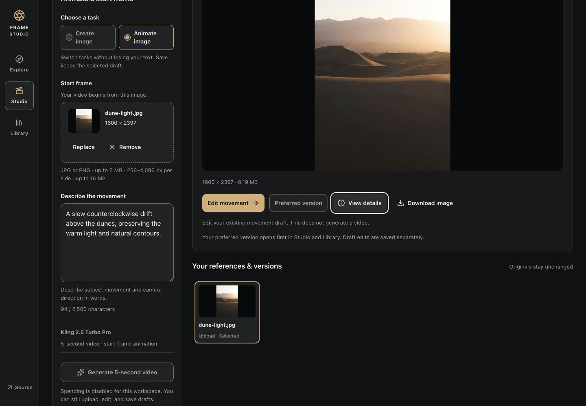

# Frame Studio · Higgsfield rebuild

A focused creative studio for the 8x assignment. Explore a prompt direction, compose a shot, retain its inputs, and inspect related work.

**The integrated application is public:** Explore, Studio, Library, private uploads and saved guest drafts run on Cloudflare Workers, D1 and private R2. Live generation remains disabled with every allowance at zero. Real AI generation and the actual camera-on walkthrough are still unverified.

- [Live application](https://higgsfield-rebuild.arhaan2.workers.dev)
- [Public source](https://github.com/Arhaan2/higgsfield-rebuild)
- [Current evidence](docs/verification/INDEX.md) and [phase status](docs/STATUS.md)
- Camera-on walkthrough: **not recorded**; [ready-to-rehearse 4:30 script](docs/WALKTHROUGH-SCRIPT.md).

## Product choices

[Signed-in research](docs/RECON.md) found useful prompt reuse and draft continuity, as well as a displayed-free flow with a paid fallback warning. The rebuild focuses on consistent task/model/action labels, visible start-frame semantics, retained inputs, and a server-enforced spending boundary. History and reuse already exist in Higgsfield; our proposed improvement is clearer local context, not invention of those features.

The user explicitly allowed implementation with the documented research gaps unverified. [Design decisions](docs/DESIGN-BRIEF.md) apply the installed Apple Design skill to a charcoal, ivory and brass cinematic workspace.

## Current verification

Published source **f271258fd0d4fece10229dfd74c89dfd5bcf275f**, containing reviewed product **b32b03e**, is Cloudflare version **cbe42062-203d-462c-949e-0d4bd380beac**. Later evidence/capture commits do not change the deployed application. [Deployment metadata](docs/verification/deployed-cloudflare.json) confirms the origin, bindings and disabled/zero policy; the initial D1 migration was not replayed.

**138 controlled checks**, **11 real hosted HTTP checks**, and **20 independent Reviewer HTTP/source checks** pass within their documented boundaries. Actual public browser checks cover upload, explicit save, reload, Library reopening, preferred-version persistence, preset-only previews, full prepared-video playback and ordinary sample/private download clicks with matching checksums. See [browser evidence](docs/verification/deployed-browser.md) and [independent hosted review](docs/verification/deployed-review.md). No provider output is claimed.



The earlier Sites URL remains a historical sample shell; its failed integrated deployments are preserved in [deployment history](docs/verification/deployment.md). Use the Workers URL above for evaluation.

## Run locally

Use Node 24.18 or newer for the included isolated test tooling, and npm. The app uses the supplied Sites Vinext starter, React/TypeScript, D1 and private R2. Exact dependency versions are in package-lock.json.

```sh
npm run install:ci
cp .env.example .env.local
npm run dev
```

Preview: http://127.0.0.1:5173 . On a new checkout, build once and apply the initial local migration once before saving drafts:

```sh
npm run build
node --import ./scripts/sites-env.mjs ./node_modules/wrangler/bin/wrangler.js d1 execute DB --local --config dist/server/wrangler.json --persist-to .wrangler/state --file drizzle/0000_cute_daredevil.sql
```

Do not replay an applied migration or alter migration history. D1 has seven tables and ten guards; no positive budget policy is seeded. Local and hosted state are separate. The direct Cloudflare database already has its initial migration applied; the deployment route reuses it without replay. Older Sites publishing attempts failed their migration runner.

```sh
npx tsc --noEmit
npm run build
node --import ./tests/server/register.mjs --test tests/server/*.test.mjs
node src/client/checks/studio-state.mjs
node src/client/checks/library-state.mjs
node src/client/checks/reference-action.mjs
```

The controlled suite now contains 36 server checks using isolated SQLite and mocked R2/provider calls, plus 58 Studio, 15 Library and 29 reference-action checks using mocked APIs/hooks. The 34 added checks cover explicit preferences, upload selection and start-frame previews; the original 104-check result remains attributed to its prior revision. Eleven actual local HTTP checks and browser upload/save/reload checks also pass; see [local evidence](docs/verification/local-browser.md) and [Phase 3 continuation](docs/verification/phase3-continuation.md). The continuation verifies ordinary sample/private download clicks and repairs a stale save notice. These checks do not prove real generation. `node scripts/verify-http.mjs http://127.0.0.1:5173` runs the actual zero-spend HTTP checks and creates isolated guest test records. This script refuses to continue if public live policy is enabled or has a nonzero cap.

`APP_ORIGIN` must exactly match the browser origin. `LIVE_GENERATION_ENABLED=false` and `GENERATION_BUDGET_USD=0` are the defaults. `FAL_KEY` is optional and server-only; a key alone does not enable generation. D1's separate budget policy also defaults to no allowance. Do not put populated secrets in tracked files or chat.

## Scope and limitations

The implementation target includes validated JPEG/PNG start frames, same-browser guest drafts, immutable media, connected reuse and two fixed fal models: FLUX schnell images and Kling 2.5 Turbo Pro five-second videos. Provider submission/retrieval, billing, and real deployed generation remain unverified. Total authorized spending is $0. Keep generation disabled unless an authorized genuinely no-cost path is verified; no paid allowance is assumed or requested. Unknown submission outcomes must not auto-resubmit. Request-driven reconciliation pauses when every browser tab closes.

Guests are private per browser cookie, with access for up to 30 days; this is not cross-device account synchronization. There is no billing UI, collaboration suite, node editor, or broad Higgsfield feature/model parity.

[Dune study media](docs/design/sample-provenance.md) is licensed prepared photography and independent stock footage. It was not created from the example prompt or generated by this application. Samples never stand in for a live result.

## Capture and delivery

[CAPTURE-TEST.md](CAPTURE-TEST.md) records actual independent canaries. Desktop and separate CLI specialist sessions are automatically captured in tracked `.agent-logs/`; native children and worktrees remain unverified and unused for production. [Capture operation](docs/capture/README.md) explains provenance and the read-only audit.

```sh
PYTHONDONTWRITEBYTECODE=1 python3 scripts/capture/verify.py
```

[Workflow](docs/WORKFLOW.md), [decisions](docs/DECISIONS.md), [acceptance](docs/ACCEPTANCE.md) and [specialist contracts](docs/agents/ASSIGNMENTS.md) preserve the incremental evidence. The actual creation-path gate and Arhaan's camera-on walkthrough under five minutes remain delivery requirements. Public integrated entry and data paths now pass. The previous [138-check repair review](docs/verification/submission-review.md) covers durable preferences, new-upload selection and preset-only previews. Native accessibility preferences and physical-phone checks remain unrun.

The capture audit preserves 38 source-matching coordinator/specialist sessions and two automatic suggestion sessions verified only against their genuine hook journals because their full transcripts are unavailable. That distinction is explicit in [capture documentation](docs/capture/README.md); no raw log was rewritten. The current coordinator final can be captured only after emission and must be committed afterward.
