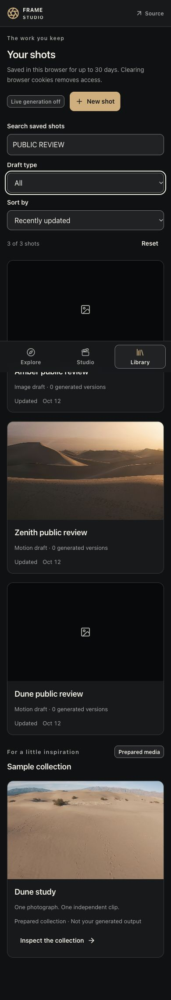
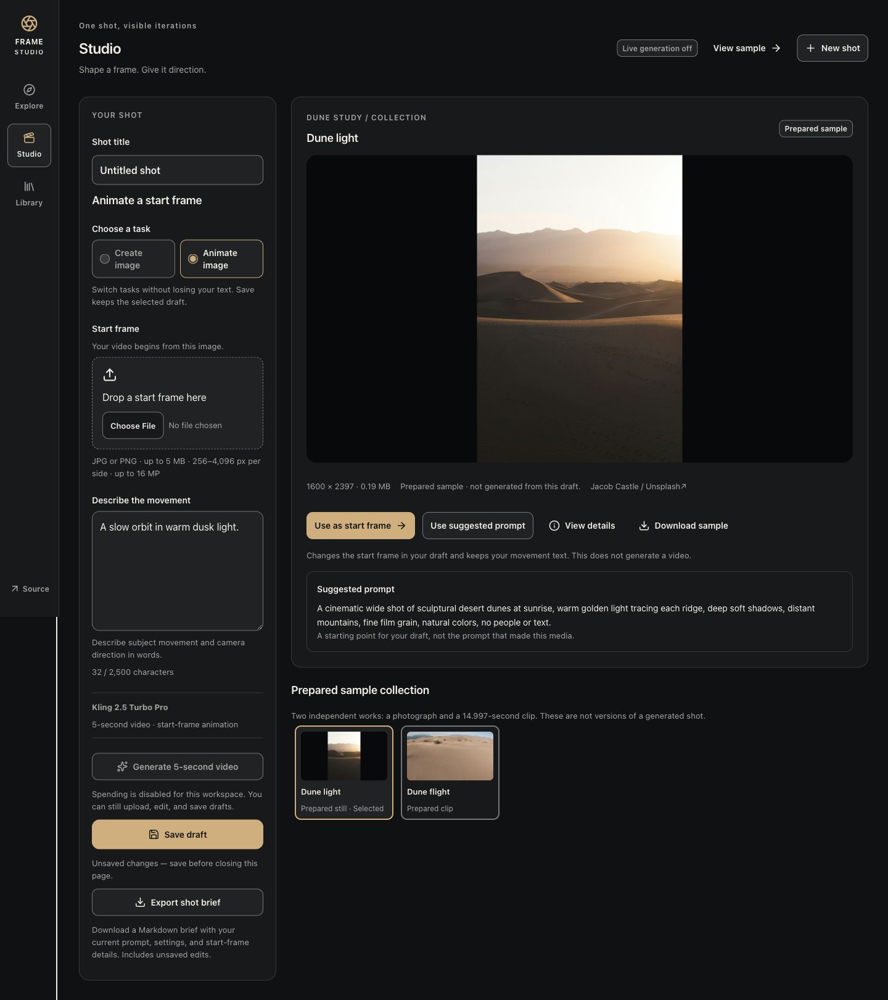

# Independent public release review

**Verdict: partial acceptance of the generation-disabled export and Library workflow. No release-blocking product defect was observed in the exercised cases.** Public upload/private-image download/preferred-upload acceptance remains unresolved because the supported upload path was blocked. The reference-versus-unrelated-inspection browser case also remains unrun. Do not mark the entire release gate passed from this report.

Reviewed 2026-10-12, starting 19:56:46 UTC; detailed observations and artifact hashes are in [the JSON evidence](final-sprint-public-review.json). Source is `0899d59108b1e92d8f1760d328ee90c643343f33`. Product files remain identical to that commit. The successful publish log and root's Cloudflare version response identify Worker `58a7f60d-5b7b-4508-b1b3-da2fe9784766`, tag `0899d59`. I did not deploy or independently query the Cloudflare management API.

Public origin: https://higgsfield-rebuild.arhaan2.workers.dev. Independent HTTP reads found both `/studio` and `/library` referencing the current entry/CSS. StudioView, LibraryView, entry JavaScript, stylesheet and client manifest were byte-identical to root's local build. This verifies served assets against that build; the build itself was not rerun. Before the first hosted save, `/api/capabilities` returned `enabled=false`, `budgetLimitMicroUsd=0`, `remainingMicroUsd=0` (request ID `bbdfc37e-ecf3-45a1-abd4-009231a2a8df`). No generation/provider request was made.

## Capture and ownership

Session `01a131b0-62be-7890-9741-184488733f93`, model `gpt-6-astra`. The full 4,798-character assignment exactly matches the native rollout and automatic `.agent-logs/2026-10-12_19-56-46_01a131b0-62be-7890-9741-184488733f93.md`; prompt SHA-256 `cd242c43e7955d497a1f93a12fc3aca7ec881b8fbe8c2a7680a94f68f28a6312`. Final response capture is pending Stop and root verification. No capture edits, delegation, worktree, source changes, installs, commits, pushes or provisioning.

Read AGENTS.md, TEAM.md, handoff template, review plan, local acceptance/download evidence, and installed `/Users/arhaan/.codex/skills/apple-design/SKILL.md`. Applied its guidance to visible focus, explicit feedback, action hierarchy, layout and type. Viewed all three prior local screenshots; those remain root's local evidence.

## Actual public observations

CUA in-app browser failed with `Browser is not available: iab`. A fresh supported Chrome tab (`1801937834`) was used. It shares the existing Chrome profile; no isolated/incognito guest was fabricated. The final Library contains exactly these three genuine saved review projects:

| Shot | Project ID | Actual contents |
| --- | --- | --- |
| Amber public review | `ef0ed94e-e482-41f7-b8f2-8e27a7bbbdb1` | Image draft; later edited and saved |
| Dune public review | `6802c2ef-5c87-4243-93fe-087e67b8e3a7` | Motion draft without start frame; upload blocked |
| Zenith public review | `ee3674e2-4ff0-4bc5-9ecf-a36491869faf` | Motion draft with prepared dune-light reference; preset created the third project |

| Check | Observed result |
| --- | --- |
| Unsaved export | Enter on Export downloaded real `shot-brief-review-cafe.md`. Exact Unicode title and 67-character prompt, multiline text, outer whitespace and embedded triple backticks survived. Wrapper uses four backticks. Safe filename; Working draft — unsaved; FLUX settings; no start frame invented. URL and unsaved UI retained. |
| Saved and edited exports | Actual Amber image, Dune motion and Zenith prepared-reference downloads have exact prompts, confirmed revision labels and correct requested settings. Edited Amber exported before save says unsaved. All omit private media/download URLs. |
| Whitespace-only export | Actual Amber `(2)` download preserves the exact 54-character whitespace-only edit and correctly says unsaved. Existing editor status still says Draft saved because the hook normalizes outer whitespace. This known, nonblocking status discrepancy does not affect exported text; restored confirmed text afterward. |
| Prepared reference | Zenith brief identifies the current dune-light.jpg reference as Prepared sample, 1600 × 2397, 187464 bytes, with Jacob Castle / Unsplash attribution. It disclaims generated lineage. |
| Search and composition | DUNE returns Dune's title and Zenith's prompt containing dunes (2/3). COBALT LANTERN + Motion + A–Z returns Dune (1/3); Image gives 0/3 with No matching shots. PUBLIC REVIEW returns all three. |
| Sorting and update | A–Z yields Amber, Dune, Zenith. Initial recent order was Zenith, Dune, Amber; saving an Amber prompt edit moved Amber first. |
| Reset and keyboard | Impossible query and composed no-match expose usable reset. Enter resets search, type=all, sort=updated and focuses library-search. Tab reaches library-filter with visible focus. Enter on a result reopens Studio. |
| Reload/reopen | Zenith title, saved Copper horizon prompt and prepared start frame survive Library reopening and explicit reload. No uploaded preference was tested. |
| Samples | Prepared sample collection remains separate through searches, filters and reset, with no generated-output claim. |
| Layout and navigation | Library and Studio scrollWidth=390 at 390px. Desktop Studio scrollWidth=1440 at 1440px. Enter on View sample focuses selected-output (top 48.09px at mobile size); Skip to content focuses main-content. Save draft is primary/enabled for edits; disabled Generate's reason remains readable. |
| Runtime | Supported review-tab warn/error log returned no entries. |

The actual unsaved file is preserved unchanged as [final-sprint-public-review-brief.md](final-sprint-public-review-brief.md). JSON preserves each of the six real download paths, full contents, hashes and assertions. Download files were read from the normal Downloads directory; a toast alone was not counted as completion.

Actual CUA screenshots, captured from the new public deployment:





These are full-page browser captures; fixed navigation appears at the capture viewport position. The viewport override was reset afterward. Browser handoff is the Library in tab `1801937834`, with all three saved shots and no pending save.

## Source and controlled evidence

Reviewed the `f271258..0899d59` product diff and current StudioView/LibraryView, shot-brief.ts, library-query.ts and CSS. The small pure formatter/query modules are readable; existing dense JSX remains but introduces no identified blocking defect. The formatter checks exact saved fields and pending save state, fences literal text safely, reads the active draft's startAssetId instead of stage selection, and restricts portable attribution URLs to canonical samples. Query operations return a new sorted array and reconcile newer revisions; loading/expiry and no-match states remain distinct.

Spot-read new focused checks for whitespace and fences, inactive-task/inspection independence, privacy, deferred save completion, no mutation/refetch, deterministic ties, newer detail merges, expiry, stale results and loaded-page pagination. Their mock React/DOM/API scope is explicit; they do not prove native download, actual network counts or browser timing. Existing root results are **180 controlled checks: 36 server, 58 Studio, 31 Library, 29 reference, 26 export**, not newly rerun by me. Root's `final-sprint-http.json` reports 11 hosted HTTP passes, including genuine upload/private bytes; those are attributed HTTP evidence, not my missing browser upload flow.

## Unresolved acceptance and limits

- The supported Chrome chooser rejected `setFiles` because its browser upload permission request was dismissed before a decision. No security setting changed and no indirect upload workaround was attempted. Root must use a supported working browser to upload the licensed image, confirm save/reload/reopen/preferred upload and inspect an ordinary private image download's actual bytes. Reuse an existing review shot if continuing in this Chrome guest to preserve the three-shot limit.
- Automatic approval review rejected selecting the independent prepared clip, interpreting “unrelated media” as a restriction. The action was not retried. Explicit clarification/approval is required before reattempting that particular selection; draft-reference-versus-inspection correctness remains controlled evidence.
- No public in-flight export timing, failure injection, expiry, stale response or pagination fixture; no independent browser network-request-count trace. No native accessibility preference changes, screen-reader speech verification, 200% zoom or physical phone test.
- Actual provider generation and the real connected image→video journey remain unverified. Budget stays zero. Original signed-in research advanced by explicit exception, not passed. Camera-on recording, length and public access remain unverified.

No product patch is requested by this review. Root owns the remaining public UI checks, final checkpoint/release decision and Git. Read-only sandbox DNS and Python HTTP-client failures were resolved with approved curl reads; they are tool limitations, not product defects.

After this session stops, root must verify the automatic final against the native source before committing it. Do not claim it is already captured or committed. Coordinator-only terminal steps after verification:

```sh
cat .agent-logs/2026-10-12_19-56-46_01a131b0-62be-7890-9741-184488733f93.md
git add -- .agent-logs/2026-10-12_19-56-46_01a131b0-62be-7890-9741-184488733f93.md docs/verification/final-sprint-public-review.md docs/verification/final-sprint-public-review.json docs/verification/final-sprint-public-review-brief.md docs/verification/final-sprint-public-review-390.jpg docs/verification/final-sprint-public-review-desktop.jpg
git diff --cached --stat
git commit -m "Record independent public export and Library review"
git push origin main
```
