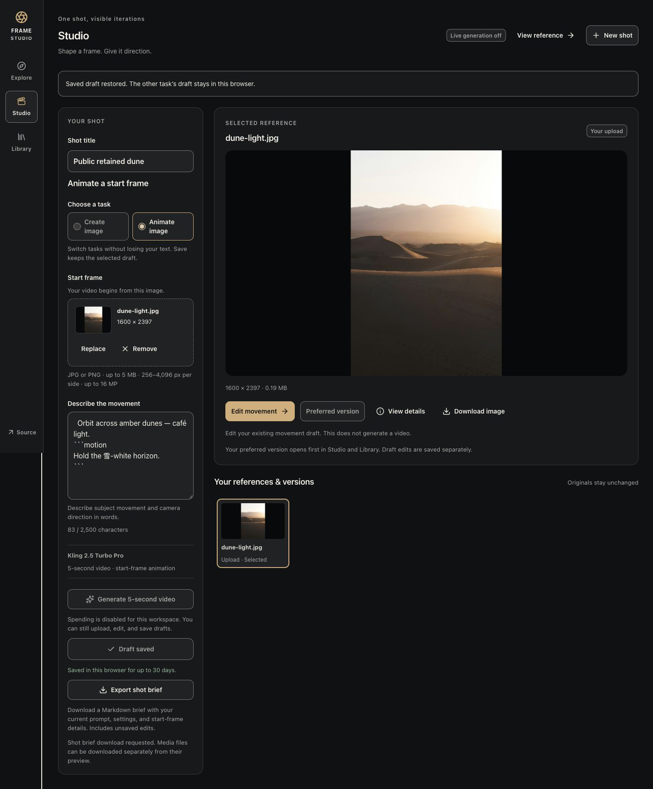

# Public upload acceptance completion

Root completed the supported in-app browser flow on 2026-10-12 at 20:09–20:11 UTC, after the independent reviewer returned browser ownership. Product source `0899d59108b1e92d8f1760d328ee90c643343f33`, Worker `58a7f60d-5b7b-4508-b1b3-da2fe9784766`. [Structured observations and hashes](final-sprint-public-upload.json).

Before any hosted write, a fresh capabilities read confirmed generation disabled and budget/remaining zero. One genuine disposable motion shot, **Public retained dune**, was added to the existing IAB guest; its two prior shots were preserved. The licensed `public/samples/dune-light.jpg` uploaded through the normal chooser. The app acknowledged the draft save, then the explicit preferred-version save. Reload and keyboard reopening from Library retained the title, prompt, uploaded reference and preferred version.

Searching the prompt with `AMBER DUNES`, Motion drafts and Title A–Z returned this shot, **1 of 3**. The prepared collection remained separate. Enter on View reference focused `selected-output`.

The actual [downloaded unsaved brief](final-sprint-public-upload-brief.md) preserves all 83 prompt characters, including outer whitespace, Unicode, newlines and embedded fences. It correctly labels the current working draft, requested Kling settings, user-upload provenance and unavailable original generation metadata. No private links occur. Export left the editor unsaved and its preference intact; the edited draft was then explicitly saved. The file was read from Downloads and opened through the app's file-panel request.

The ordinary Download image link produced a real 187,464-byte JPEG. Its SHA-256 is `4d5d695a1fc7745268274c89663550be54a7416942e56f13f6675a625584442a`, exactly matching the uploaded file. The desktop document width equals the 1440px viewport; viewport override was reset after the screenshot.

This closes the upload-related browser gap in the [independent report](final-sprint-public-review.md) with separately attributed coordinator evidence. It does not turn that specialist's blocked upload into a pass. The specialist's new public prepared-clip selection remains unrun after automatic approval review rejected it; root did not retry that action. Earlier playback evidence and controlled reference-versus-inspection checks retain their original scope. No security setting, infrastructure, migration, provider call or billing setting changed. Real generation and the actual camera-on recording remain unverified.
